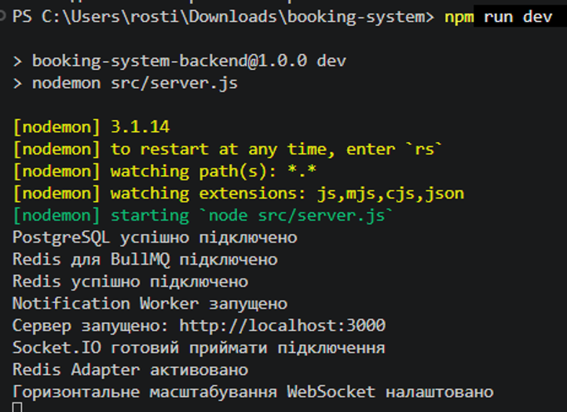
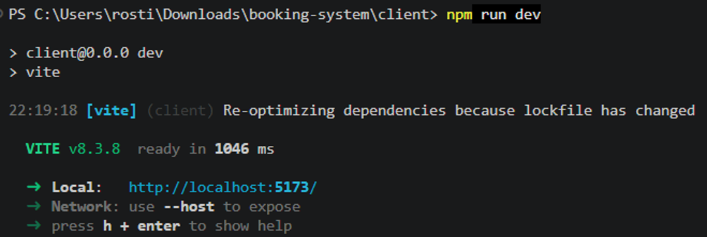
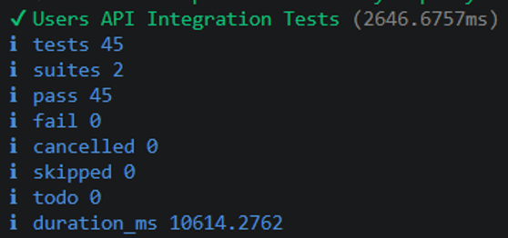
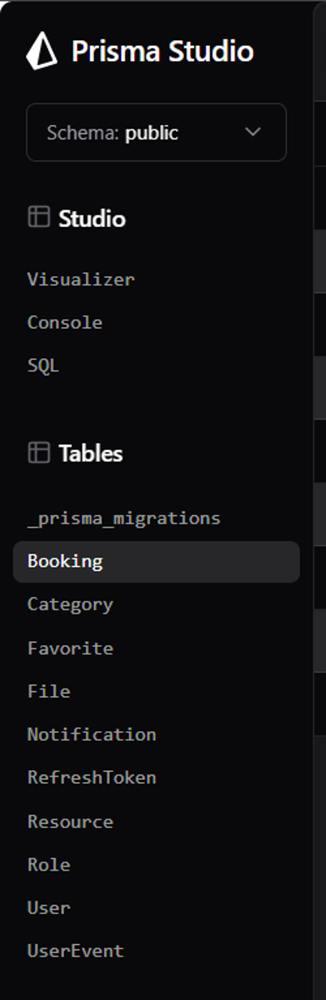
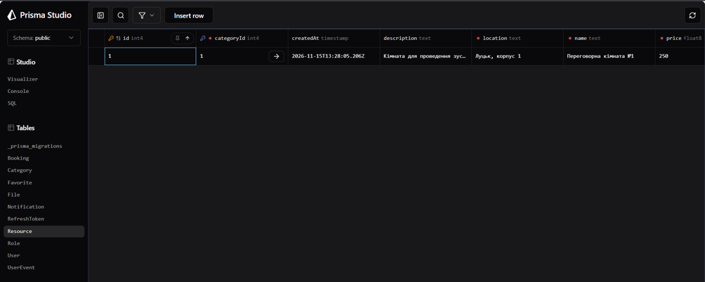
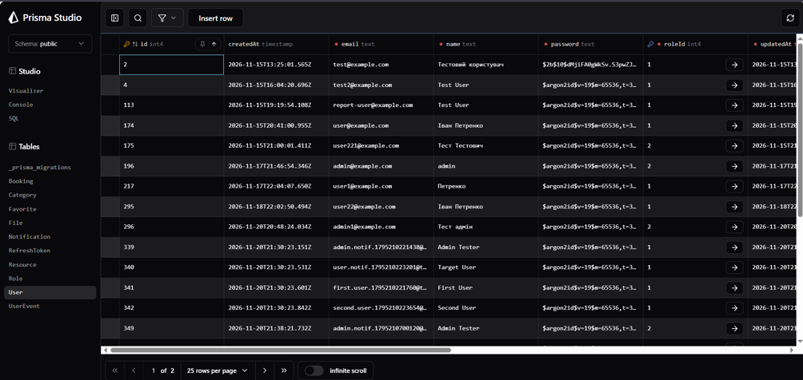
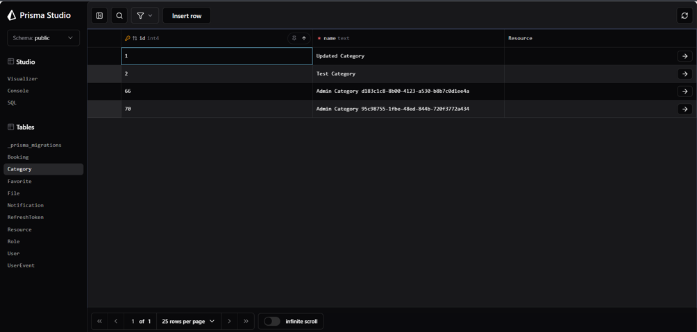
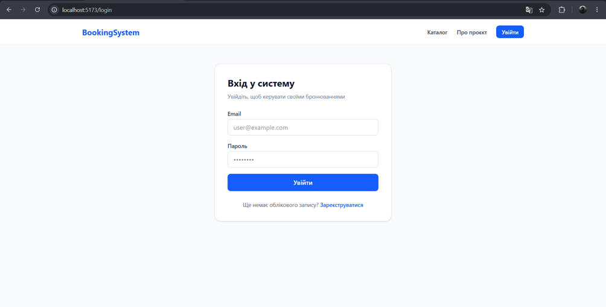
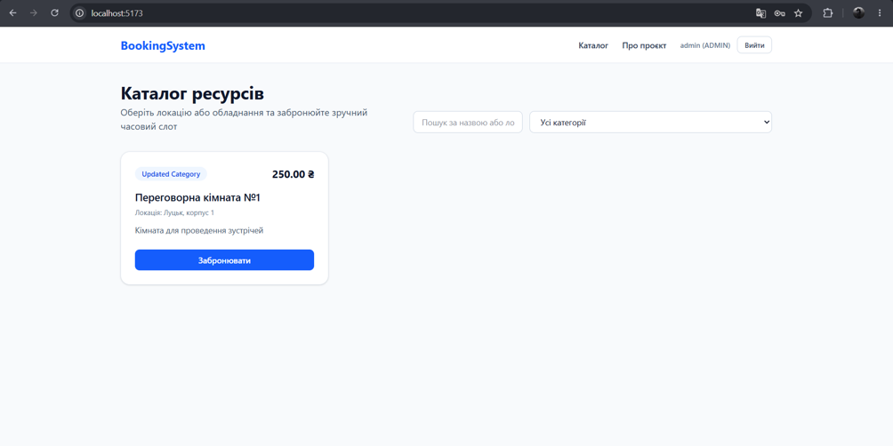
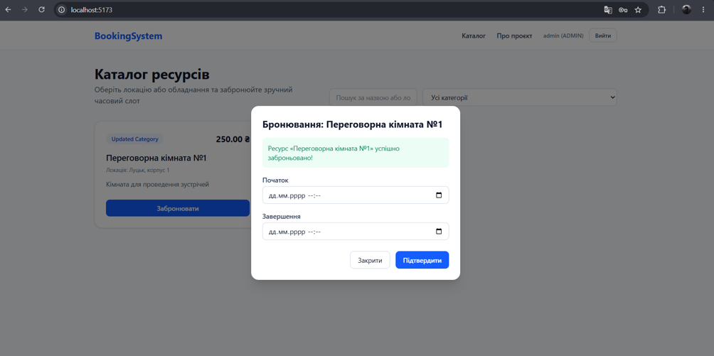

# Booking System — Система бронювання ресурсів

## Опис проєкту
**Booking System** це клієнтський вебзастосунок для автоматизації перегляду та бронювання спільних ресурсів. Застосунок надає зручний інтерфейс для взаємодії користувачів із системою резервування та працює у зв'язці з REST API серверної частини.

**Основні можливості:**
- реєстрація та автентифікація користувачів із використанням JWT-токенів;
- перегляд каталогу доступних ресурсів та пошук за категоріями;
- створення бронювання з вибором дати й часового інтервалу та клієнтською валідацією даних;
- адаптивний користувацький інтерфейс із підтримкою перемикання теми оформлення.

## Технології
- React 19
- TypeScript
- Vite
- Tailwind CSS 4
- React Router 8
- Axios
- ESLint + Prettier

## Встановлення та запуск

### Вимоги
- Node.js 24 LTS
- npm

### Інструкції
```bash
# Клонування репозиторію
git clone [https://github.com/Shin1-gami/booking-system]

# Перехід до директорії клієнта 
cd client

# Встановлення залежностей
npm install

# Копіювання .env файлу
cp .env.example .env

# Запуск у режимі розробки
npm run dev

# Збірка для продакшену
npm run build
```

## Структура проєкту
```
src/
├── components/      # Повторно використовувані UI-компоненти (Layout, Header, Footer, модальні вікна)
├── pages/           # Компоненти сторінок (каталог ресурсів, сторінка входу/реєстрації, про проєкт)
├── services/        # API-сервіси та конфігурація HTTP-клієнта Axios
├── types/           # Типи та інтерфейси TypeScript
├── utils/           # Допоміжні функції форматування та валідації
└── hooks/           # Власні хуки React
```

## Скріншоти

## Запуск сервера





### Виконання автотестів



## Prisma Studio









## Інтерфейс клієнтської частини







## Автор
[Величко Ростислав, ІПЗ-42]