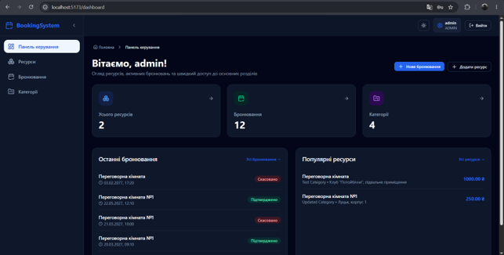

# BookingSystem — Система онлайн-бронювання ресурсів

> Повнофункціональний вебзастосунок (full-stack) на React та Node.js

## 🎯 Опис проєкту

**BookingSystem** — це інформаційна вебсистема для обліку, планування та онлайн-бронювання спільних ресурсів (конференц-залів, переговорних кімнат, робочих місць та спеціалізованого обладнання).

**Основні цілі та можливості застосунку:**
- **Запобігання конфліктам бронювання:** перевірка перетину часових слотів на рівні бази даних PostgreSQL із використанням транзакцій Prisma ORM.
- **Рольове розмежування доступу (`USER` / `ADMIN`):** звичайні користувачі можуть переглядати каталог ресурсів, створювати власні бронювання та керувати їхнім статусом, а адміністратори мають повний доступ до управління ресурсами, категоріями та підтвердження заявок.
- **Взаємодія в реальному часі:** миттєва доставка сповіщень через чергу повідомлень BullMQ та WebSocket (Socket.IO), відстеження онлайн-статусу користувачів і жива синхронізація списків бронювань без перезавантаження сторінки.
- **Сучасний користувацький досвід (UX) та офлайн-робота:** підтримка Progressive Web App (PWA) із кешуванням даних через Service Worker, інтерактивна аналітика, календар бронювань, сортування завдань перетягуванням та завантаження зображень із попереднім обрізанням.

## ✨ Функціональність

### Серверна частина
- ✅ RESTful API на Node.js + Express 5
- ✅ База даних PostgreSQL з Prisma ORM 7
- ✅ Аутентифікація JWT (токени доступу й оновлення з ротацією та хешуванням)
- ✅ WebSocket (Socket.io + Redis Adapter) для обміну даними в реальному часі (сповіщення, онлайн-присутність, кімнати ресурсів)
- ✅ Асинхронна обробка фонових сповіщень через Redis + BullMQ
- ✅ Файловий сервіс завантаження зображень і документів (`/api/files/upload`)
- ✅ Документація API (Swagger `/api-docs`) та моніторинг (`/health`, `/metrics`)

### Клієнтська частина
- ✅ React 19 + TypeScript 6
- ✅ Система аутентифікації та рольові захищені маршрути (`ProtectedRoute`)
- ✅ CRUD-інтерфейси для всіх сутностей (ресурси, бронювання, категорії)
- ✅ Оновлення в реальному часі через Socket.io (`NotificationBell`, `OnlineStatusBadge`, автоматичне оновлення кешу)
- ✅ Валідація форм (React Hook Form + Zod)
- ✅ Доступні інтерактивні компоненти на базі Headless UI v2 (модальні вікна, таби, пошуковий випадаючий список)
- ✅ Перетягування елементів (dnd-kit — інтерактивний чекліст адміністрування)
- ✅ Графіки та візуалізації (Recharts), інтерактивний календар (`react-day-picker`), нескінченне прокручування (`useInfiniteQuery` + `IntersectionObserver`), обрізання зображень (`react-easy-crop`) та WYSIWYG-редактор (`Tiptap`)
- ✅ PWA з офлайн-підтримкою (`vite-plugin-pwa` + Workbox) та індикатором стану мережі
- ✅ Адаптивний дизайн (Tailwind CSS 4) зі світлою та темною темами

## 🛠 Технології

### Серверна частина
- Node.js 24 LTS
- Express.js 5
- PostgreSQL
- Prisma ORM 7
- Socket.io (`@socket.io/redis-adapter`)
- Redis + BullMQ
- JWT + Argon2id (хешування паролів)
- Multer (файли)
- Zod + Swagger (`swagger-ui-express`)

### Клієнтська частина
- React 19
- TypeScript 6
- Vite 8
- Tailwind CSS 4
- React Router 7
- Axios
- Socket.io-client
- Zustand 5 (клієнтський стан) та TanStack Query 5 (дані сервера)
- React Hook Form + Zod
- Headless UI 2
- Recharts (графіки)
- dnd-kit (перетягування)
- Tiptap, react-easy-crop, react-day-picker, Motion
- `vite-plugin-pwa`, Vitest + React Testing Library

## 📦 Встановлення та запуск

### Вимоги
- Node.js 24 LTS
- PostgreSQL 15+
- Redis 7+
- npm

### Серверна частина

```bash
# Клонування репозиторію
git clone [https://github.com/Shin1-gami/booking-system.git](https://github.com/Shin1-gami/booking-system.git)
cd booking-system

# Встановлення залежностей
npm install

# Налаштування .env
cp .env.example .env
# Встановити DATABASE_URL, REDIS_URL, JWT_SECRET, JWT_REFRESH_SECRET, CLIENT_URL

# Міграція бази даних, генерація клієнта Prisma та початкові дані
npx prisma migrate deploy
npx prisma generate
npx prisma db seed

# Запуск сервера
npm run dev
```

### Клієнтська частина

```bash
cd client

# Встановлення залежностей
npm install

# Генерація PWA-іконок (за потреби)
npm run pwa:icons

# Налаштування .env
cp .env.example .env
# Встановити VITE_API_URL=http://localhost:3000/api
# та VITE_SOCKET_URL=http://localhost:3000

# Запуск у режимі розробки
npm run dev
```

## 🚀 Розгортання

### Серверна частина
Розгорнуто на: Render  
URL: `https://booking-system-api.onrender.com`

### Клієнтська частина
Розгорнуто на: Vercel  
URL: `https://booking-system-client.vercel.app`

### Змінні середовища

**Серверна частина (Render):**
- `NODE_ENV` — режим роботи (`production`)
- `PORT` — порт HTTP-сервера (`3000`)
- `DATABASE_URL` — рядок підключення до PostgreSQL
- `REDIS_URL` — рядок підключення до Redis (для BullMQ та Socket.IO)
- `JWT_SECRET` — секретний ключ підпису Access-токенів
- `JWT_REFRESH_SECRET` — секретний ключ підпису Refresh-токенів
- `CLIENT_URL` та `FRONTEND_URL` — публічний URL клієнтського застосунку на Vercel (для CORS і WebSocket)

**Клієнтська частина (Vercel):**
- `VITE_API_URL` — базовий URL серверного REST API (`https://booking-system-api.onrender.com/api`)
- `VITE_SOCKET_URL` — URL WebSocket-сервера без префікса `/api` (`https://booking-system-api.onrender.com`)
- `VITE_APP_NAME` — назва застосунку (`BookingSystem`)
- `VITE_APP_ENV` — середовище збірки (`production`)

**Порядок налаштування:**
1. Розгорнути серверну частину на Render разом із PostgreSQL та Redis, виконати міграції Prisma й отримати публічний URL API.
2. У налаштуваннях проєкту клієнта на Vercel задати змінні середовища `VITE_API_URL` та `VITE_SOCKET_URL` і виконати збірку.
3. Отриманий URL клієнта на Vercel додати у змінні `CLIENT_URL` та `FRONTEND_URL` на сервері Render і перезапустити сервіс для коректної роботи CORS і Socket.IO.

## 📁 Структура проєкту

### Серверна частина
```text
booking-system/
├── src/
│   ├── config/         # Конфігурація Prisma, Redis, BullMQ, Swagger, Prometheus
│   ├── controllers/    # Бізнес-логіка обробки запитів
│   ├── routes/         # API-маршрути
│   ├── middleware/     # Проміжні обробники (JWT, ролі, валідація Zod, Multer)
│   ├── queues/         # Черги фонових завдань BullMQ
│   ├── services/       # Сервісний шар
│   ├── socket/         # Обробники подій Socket.io
│   ├── workers/        # Воркери обробки сповіщень
│   └── utils/          # Допоміжні функції
├── prisma/
│   ├── migrations/     # Міграції бази даних
│   ├── schema.prisma   # Схема БД
│   └── seed.js         # Початкові ролі та тестові записи
├── tests/              # Інтеграційні тести сервера
└── uploads/            # Завантажені файли
```

### Клієнтська частина
```text
client/
├── src/
│   ├── components/
│   │   ├── auth/           # Захищені та гостьові маршрути
│   │   ├── common/         # Modal, ConfirmDialog, Tabs, SearchableSelect, OnlineStatusBadge
│   │   ├── data-display/   # Таблиці, сітки, фільтри та пагінація
│   │   ├── interactive/    # TaskBoard, StatsChart, InfiniteResourcesFeed, ImageCropUploader, BookingCalendar, RichTextEditor
│   │   └── layout/         # Layout, DashboardLayout, Header, Sidebar, Footer
│   ├── constants/      # Конфігурація API та Socket.io
│   ├── pages/          # Сторінки застосунку (Home, Dashboard, Resources, Bookings, Categories, Auth)
│   ├── services/       # API-сервіси (Axios) та клієнт Socket.io
│   ├── stores/         # Сховища Zustand (auth, ui, notifications, presence)
│   ├── schemas/        # Схеми валідації Zod
│   ├── types/          # Типи та інтерфейси TypeScript
│   ├── hooks/          # Власні хуки (useSocketConnection, useSocketEvent, useOnlineStatus, TanStack Query)
│   └── test/           # Конфігурація тестового середовища Vitest
├── scripts/            # Генератор іконок PWA
├── public/             # Статичні файли, PWA-іконки, robots.txt, sitemap.xml
├── vercel.json         # Налаштування SPA-маршрутизації та кешування SW
└── vite.config.ts      # Конфігурація Vite, PWA, Code Splitting та Vitest
```

## 📸 Скріншоти

### Головна сторінка


### Dashboard


### CRUD-інтерфейс


### Оновлення в реальному часі


## 🔑 Тестові облікові дані

```text
Адміністратор:
Email: admin@example.com
Password: Password123

Користувач:
Email: user@example.com
Password: Password123
```

## 📊 Продуктивність

Результати вимірювання Lighthouse на розгорнутій версії застосунку:

- Performance / Accessibility / Best Practices / SEO: **96 / 98 / 100 / 100**
- Розмір початкового завантаження (gzip): **~118 КБ** (важкі модулі Recharts, Tiptap та календаря винесені в окремі lazy chunks)
- LCP: **1.2 с**, INP: **45 мс**, CLS: **0.01**

## 🔐 Безпека

- JWT-токени з обмеженим терміном дії (токен оновлення з ротацією та SHA-256 хешуванням у БД)
- Хешування паролів Argon2id
- Автентифікація WebSocket-з'єднань Socket.io за JWT-токеном
- Налаштування CORS для дозволених доменів клієнта
- Валідація вхідних даних на клієнті та сервері за допомогою схем Zod
- Захист від SQL-ін'єкцій завдяки параметризованим запитам Prisma ORM
- Захист від XSS (автоматичне екранування у React, HTTP-заголовки безпеки Helmet)
- Обмеження частоти запитів (rate limiting)

## 📝 Документація API

Swagger-документація доступна за адресою: `/api-docs`

## 🧪 Тестування

```bash
# Тести серверної частини
npm test

# Тести клієнтської частини
cd client
npm test
```

## 👨‍💻 Автор

**Величко Ростислав**
- Група: ІПЗ-42
- Email: [rostyslav.velychko3@gmail.com]
- GitHub: [@Shin1-gami](https://github.com/Shin1-gami/booking-system)