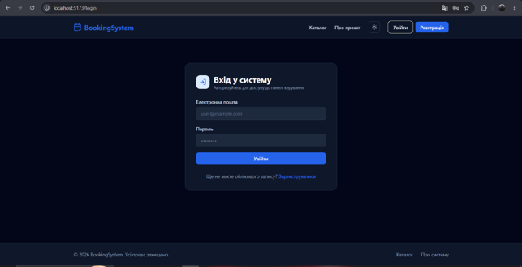
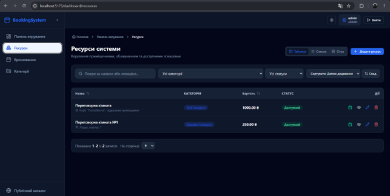
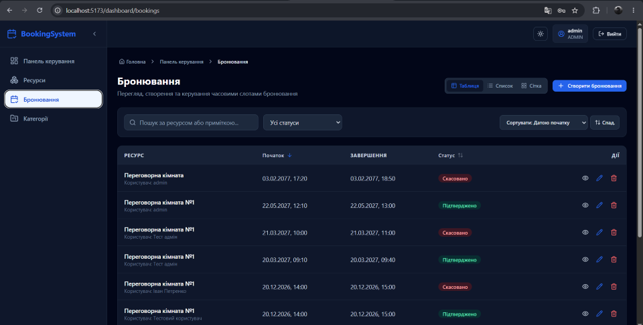
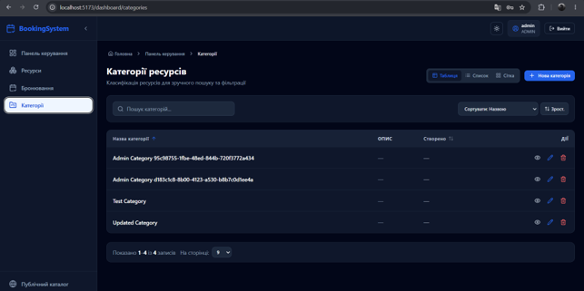
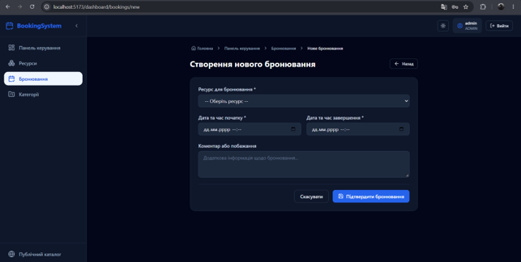

# Система онлайн-бронювання ресурсів (Booking System)

## Опис проєкту
Повноцінний вебзастосунок для управління ресурсами, категоріями та бронюваннями з розмежуванням прав доступу (`USER` / `ADMIN`). Проєкт складається з REST API серверної частини на Node.js/Express + PostgreSQL та клієнтського SPA-застосунку на React 19 + TypeScript.

Клієнтська частина забезпечує повний цикл роботи з даними: реєстрацію та авторизацію за допомогою JWT-токенів із автоматичним оновленням сесії, захищені маршрути, перегляд каталогу ресурсів із пошуком, фільтрацією, сортуванням та пагінацією, а також створення, редагування та скасування бронювань із клієнтською та серверною валідацією.

## Функціональність
- ✅ Аутентифікація та авторизація на базі JWT (Access + Refresh токени з автоматичним рефрешем через Axios Interceptors)
- ✅ Захищені маршрути (`ProtectedRoute`) та рольова модель доступу (`USER` / `ADMIN`)
- ✅ Повні CRUD-операції для ресурсів, категорій та бронювань
- ✅ Валідація форм на клієнті та сервері (React Hook Form + Zod)
- ✅ Управління клієнтським станом (Zustand) та кешування серверних даних (TanStack Query)
- ✅ Сповіщення користувача про результати операцій та помилки (Toast)
- ✅ Пошук, багатокритеріальна фільтрація, сортування, перемикання режимів відображення та пагінація
- ✅ Скелетні індикатори завантаження (`Skeleton`) та обробка помилок (`ErrorBoundary`)
- ✅ Real-time події та черги фонових задач (Socket.IO + Redis / BullMQ)

## Технології

### Frontend (`client/`)
- React 19 + TypeScript
- Vite
- Tailwind CSS
- React Router
- Axios
- React Hook Form + Zod
- Zustand
- TanStack Query
- React Hot Toast

### Backend (`src/`, `prisma/`)
- Node.js + Express
- PostgreSQL + Prisma ORM
- Redis + BullMQ
- Socket.IO
- JSON Web Token (JWT) + bcrypt
- Swagger (OpenAPI документація)

## API-ендпоїнти

### Аутентифікація (`/api/auth`)
| Метод | Ендпоїнт | Опис | Доступ |
| :--- | :--- | :--- | :--- |
| `POST` | `/api/auth/register` | Реєстрація нового користувача | Публічний |
| `POST` | `/api/auth/login` | Вхід у систему та отримання пари JWT-токенів | Публічний |
| `POST` | `/api/auth/refresh` | Оновлення Access та Refresh токенів | Публічний |
| `POST` | `/api/auth/logout` | Вихід із системи та відкликання Refresh токена | Публічний |

### Ресурси (`/api/resources`)
| Метод | Ендпоїнт | Опис | Доступ |
| :--- | :--- | :--- | :--- |
| `GET` | `/api/resources` | Список ресурсів (пошук, фільтри за категорією/ціною/локацією, сортування, пагінація) | Публічний |
| `GET` | `/api/resources/:id` | Детальна інформація про ресурс | Публічний |
| `POST` | `/api/resources` | Створення нового ресурсу | `ADMIN` |
| `PUT` | `/api/resources/:id` | Оновлення даних ресурсу | `ADMIN` |
| `DELETE` | `/api/resources/:id` | Видалення ресурсу | `ADMIN` |

### Категорії (`/api/categories`)
| Метод | Ендпоїнт | Опис | Доступ |
| :--- | :--- | :--- | :--- |
| `GET` | `/api/categories` | Отримання списку всіх категорій | Публічний |
| `GET` | `/api/categories/:id` | Детальна інформація про категорію | Публічний |
| `POST` | `/api/categories` | Створення нової категорії | `ADMIN` |
| `PUT` | `/api/categories/:id` | Оновлення категорії | `ADMIN` |
| `DELETE` | `/api/categories/:id` | Видалення категорії | `ADMIN` |

### Бронювання (`/api/bookings`)
| Метод | Ендпоїнт | Опис | Доступ |
| :--- | :--- | :--- | :--- |
| `GET` | `/api/bookings` | Список бронювань (власних для `USER`, усіх для `ADMIN`) | Авторизований |
| `GET` | `/api/bookings/:id` | Детальна інформація про бронювання | Власник / `ADMIN` |
| `POST` | `/api/bookings` | Створення бронювання з перевіркою конфліктів часу | Авторизований |
| `PUT` | `/api/bookings/:id` | Оновлення часу або статусу бронювання | Власник / `ADMIN` |
| `DELETE` | `/api/bookings/:id` | Скасування бронювання (`CANCELLED`) | Власник / `ADMIN` |

## Встановлення та запуск

### Вимоги
- Node.js 24 LTS
- PostgreSQL 15+
- Redis 7+

### 1. Запуск серверної частини (корінь проєкту)
```bash
# Клонування репозиторію
git clone [https://github.com/Shin1-gami/booking-system]
cd booking-system

# Встановлення залежностей бекенда
npm install

# Налаштування змінних середовища (.env)
cp .env.example .env

# Застосування міграцій та наповнення БД початковими даними
npx prisma migrate deploy
npx prisma db seed

# Запуск сервера розробки на http://localhost:3000
npm run dev
```

### 2. Запуск клієнтської частини (`client/`)
```bash
cd client

# Встановлення залежностей фронтенда
npm install

# Налаштування змінних середовища
cp .env.example .env
# Переконайтеся, що у client/.env вказано:
# VITE_API_URL=http://localhost:3000/api

# Запуск клієнта у режимі розробки на http://localhost:5173
npm run dev
```

## Структура проєкту
```text
booking-system/
├── prisma/
│   ├── migrations/            # Міграції бази даних PostgreSQL
│   ├── schema.prisma          # Схема моделей Prisma
│   └── seed.js                # Скрипт початкового заповнення БД
├── src/                       # Серверна частина (Express API)
│   ├── config/                # Конфігурація Prisma, Redis, Swagger, метрик
│   ├── controllers/           # Контролери бізнес-логіки
│   ├── middleware/            # Автентифікація, перевірка ролей, валідація, обробка помилок
│   ├── queues/                # Черги сповіщень BullMQ
│   ├── routes/                # Маршрути REST API
│   ├── schemas/               # Схеми валідації запитів Zod
│   ├── services/              # Сервісний шар
│   ├── socket/                # Обробники WebSocket (Socket.IO)
│   └── utils/                 # Допоміжні утиліти (JWT, кеш, логування)
├── client/                    # Клієнтська частина (React + TypeScript)
│   └── src/
│       ├── components/
│       │   ├── auth/          # ProtectedRoute для захисту маршрутів
│       │   ├── common/        # Базові UI-компоненти (Button, Input, Pagination, Skeleton, Toast)
│       │   ├── data-display/  # Таблиці, картки, списки, панель фільтрів
│       │   └── layout/        # Header, Sidebar, Footer, DashboardLayout
│       ├── constants/         # Конфігурація клієнта
│       ├── hooks/             # Власні хуки та хуки TanStack Query
│       ├── pages/             # Сторінки (Auth, Dashboard, Resources, Bookings, Categories)
│       ├── schemas/           # Схеми валідації форм Zod
│       ├── services/          # API-клієнт Axios та сервіси запитів
│       ├── stores/            # Сховища стану Zustand (authStore, uiStore)
│       ├── types/             # TypeScript-інтерфейси та DTO
│       └── utils/             # Форматування та обробка помилок API
├── tests/                     # Інтеграційні тести API
├── reports/                   # Звіти та скріншоти до лабораторних робіт
└── README.md
```

## Скріншоти

- **Сторінка входу:**



- **Панель керування (Dashboard):** 


- **Каталог ресурсів із фільтрацією та пагінацією:** 



- **Список бронювань:** 



- **Категорії ресурсів:** 



- **Форма створення / редагування:** 



## Використання

### Тестові облікові записи
```text
Адміністратор:
Email: admin@example.com
Password: Password123

Користувач:
Email: user@example.com
Password: Password123
```

## Автор
[Величко Ростислав], група [ІПЗ-42]
