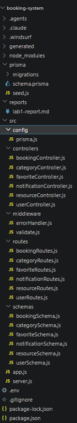
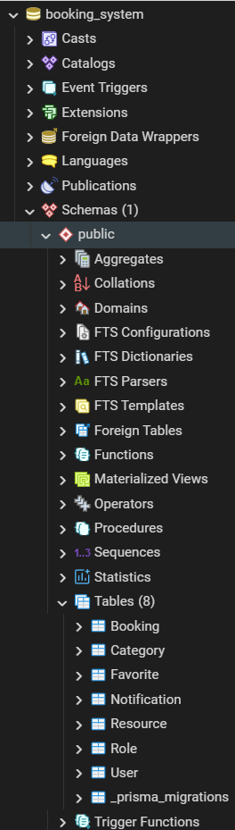
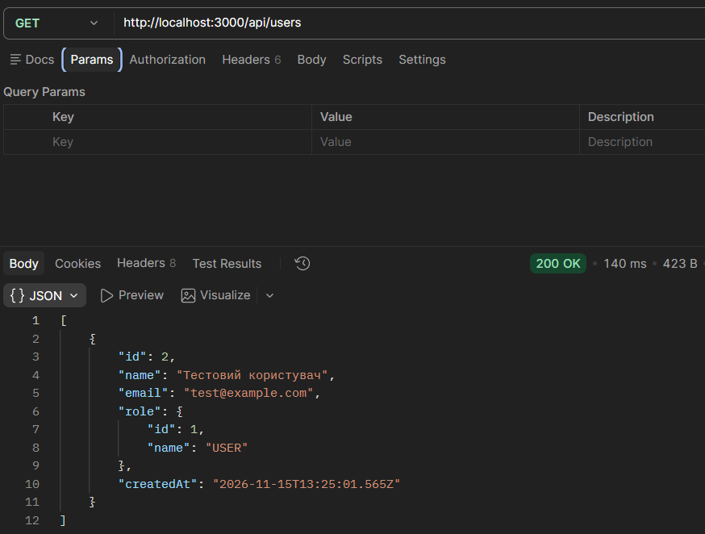
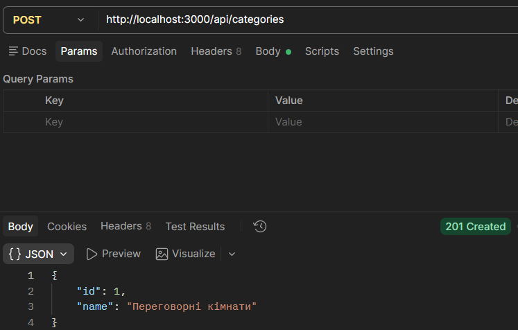
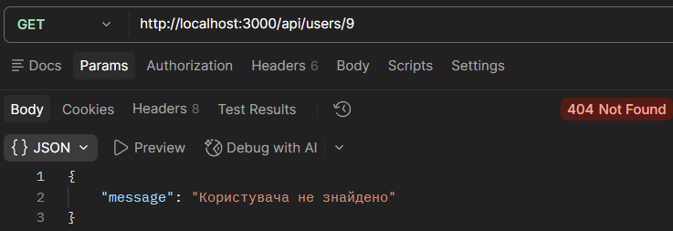
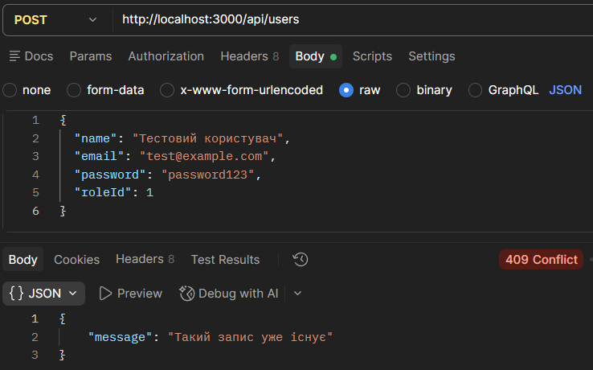
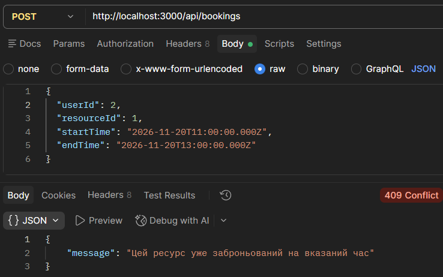
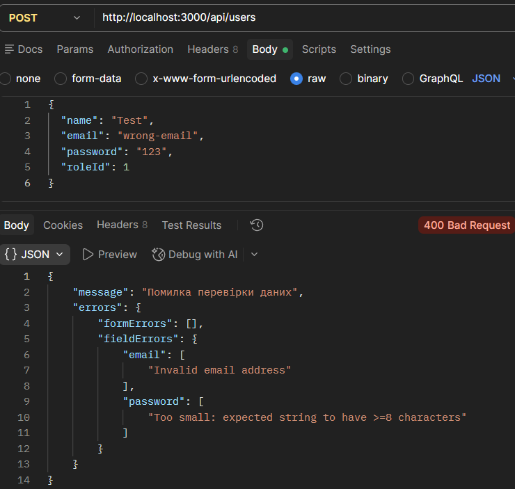

# Звіт з лабораторної роботи 1

## Тема роботи: Розроблення backend архітектури та основного функціоналу

Здобувач освіти: [Величко Ростислав Володимирович]
Група: [ІПЗ-42]
GitHub репозиторій: [https://github.com/Shin1-gami/booking-system]

## Виконання роботи

### Налаштування проєкту
- Створено Git-репозиторій для зберігання проєкту.
- Ініціалізовано Node.js-проєкт.
- Встановлено Express.js для створення backend-сервера.
- Встановлено необхідні залежності: Prisma, PostgreSQL-драйвер, Zod, bcrypt, dotenv та cors.
- Налаштовано структуру папок і файлів відповідно до MVC-архітектури.
- Налаштовано змінні середовища у файлі .env.
- Підготовлено сервер для запуску REST API.

### База даних
- Обрано PostgreSQL як систему керування базами даних.
- Створено базу даних booking_system.
- Налаштовано Prisma ORM для взаємодії з базою даних.
- Створено Prisma-схему з такими моделями: Role, User, Category, Resource, Booking, Notification та Favorite.
- Визначено зв'язки між моделями за допомогою первинних і зовнішніх ключів.
- Передбачено унікальність електронної пошти користувачів.
- Реалізовано збереження інформації про бронювання, ресурси, сповіщення та обране.

### Backend архітектура
- Створено сервер на основі Express.js.
- Реалізовано MVC-архітектуру з розподілом логіки між контролерами та маршрутами.
- Створено контролери для користувачів, категорій, ресурсів, бронювань, сповіщень та обраного.
- Створено окремі файли маршрутів для кожної сутності.
- Реалізовано middleware для перевірки вхідних даних за допомогою Zod.
- Реалізовано централізовану обробку помилок.
- Додано хешування паролів користувачів за допомогою bcrypt.
- Реалізовано перевірку існування користувача та ресурсу перед створенням бронювання.
- Передбачено перевірку перетину часових проміжків для запобігання бронюванню вже зайнятого ресурсу.

### API endpoints
Для взаємодії з backend-частиною розроблено REST API. Основні маршрути:
1. Користувачі — /api/users
| Метод | Endpoint | Призначення |
| :--- | :--- | :--- |
| GET | `/api/users` | Отримання всіх користувачів |
| GET | `/api/users/:id` | Отримання користувача за ID |
| POST | `/api/users` | Створення користувача |
| PUT | `/api/users/:id` | Оновлення користувача |
| DELETE | `/api/users/:id` | Видалення користувача |

2. Категорії — /api/categories
| Метод | Endpoint | Призначення |
| :--- | :--- | :--- |
| GET | `/api/categories` | Отримання всіх категорій |
| GET | `/api/categories/:id` | Отримання категорії за ID |
| POST | `/api/categories` | Створення категорії |
| PUT | `/api/categories/:id` | Оновлення категорії |
| DELETE | `/api/categories/:id` | Видалення категорії |

3. Ресурси — /api/resources
| Метод | Endpoint | Призначення |
| :--- | :--- | :--- |
| GET | `/api/resources` | Отримання всіх ресурсів |
| GET | `/api/resources/:id` | Отримання ресурсу за ID |
| POST | `/api/resources` | Створення ресурсу |
| PUT | `/api/resources/:id` | Оновлення ресурсу |
| DELETE | `/api/resources/:id` | Видалення ресурсу |

4. Бронювання — /api/bookings
| Метод | Endpoint | Призначення |
| :--- | :--- | :--- |
| GET | `/api/bookings` | Отримання всіх бронювань |
| GET | `/api/bookings/:id` | Отримання бронювання за ID |
| POST | `/api/bookings` | Створення бронювання |
| PUT | `/api/bookings/:id` | Оновлення бронювання |
| DELETE | `/api/bookings/:id` | Видалення бронювання |

5. Сповіщення — /api/notifications
| Метод | Endpoint | Призначення |
| :--- | :--- | :--- |
| GET | `/api/notifications?userId=1` | Отримання сповіщень користувача |
| POST | `/api/notifications` | Створення сповіщення |
| PUT | `/api/notifications/:id` | Оновлення сповіщення |
| DELETE | `/api/notifications/:id` | Видалення сповіщення |

6. Обране — /api/favorites
| Метод | Endpoint | Призначення |
| :--- | :--- | :--- |
| GET | `/api/favorites?userId=1` | Отримання обраних ресурсів |
| POST | `/api/favorites` | Додавання ресурсу до обраного |
| DELETE | `/api/favorites/:resourceId?userId=1` | Видалення ресурсу з обраного |

## Структура проєкту

```
booking-system:
|   .env
|   .gitignore
|   package-lock.json
|   package.json
|   prisma7.config.ts
|   README.md
|   skills-lock.json
|   structure.txt
|                  
+---generated
|   \---prisma
|               
+---prisma
|   |   schema.prisma
|   |   seed.js
|   |   
|   \---migrations
|       |   migration_lock.toml
|               
+---reports
|       lab1-report.md
|       
\---src
    |   app.js
    |   server.js
    |   
    +---config
    |       prisma.js
    |       
    +---controllers
    |       bookingController.js
    |       categoryController.js
    |       favoriteController.js
    |       notificationController.js
    |       resourceController.js
    |       userController.js
    |       
    +---middleware
    |       errorHandler.js
    |       validate.js
    |       
    +---routes
    |       bookingRoutes.js
    |       categoryRoutes.js
    |       favoriteRoutes.js
    |       notificationRoutes.js
    |       resourceRoutes.js
    |       userRoutes.js
    |       
    \---schemas
            bookingSchema.js
            categorySchema.js
            favoriteSchema.js
            notificationSchema.js
            resourceSchema.js
            userSchema.js
            
```

## Скріншоти тестування
Скріншот 1. Структура проєкту


Скріншот 2. База даних PostgreSQL


Скріншот 3. GET-запит


Скріншот 4. POST-запит


Скріншот 5. Перевірка отримання неіснуючого користувача


Скріншот 6. Перевірка повторного створення користувача


Скріншот 7. Перевірка бронювання на зайнятий час


Скріншот 8. Перевірка неправильного формату пошти



## Висновки

Самооцінка: [4/5]

Обгрунтування: Реалізовано основний функціонал системи бронювання, створено базу даних, налаштовано backend-архітектуру та розроблено REST API. Передбачено перевірку даних і обробку помилок. Водночас проєкт можна вдосконалити шляхом додавання авторизації користувачів, розмежування прав доступу та додаткових механізмів безпеки.