# Звіт з лабораторної роботи 2

## Тема роботи: Аутентифікація, авторизація та розширений функціонал

**Здобувач освіти:** [Величко Ростислав Володимирович]  
**Група:** [ІПЗ-42]  
**GitHub репозиторій:** https://github.com/Shin1-gami/booking-system  
**Рівень складності:** 3

## Реалізований функціонал

Розроблено Backend REST API для системи бронювання з використанням Node.js, Express.js, PostgreSQL та Prisma ORM.

Основні реалізовані можливості:

1. **Аутентифікація користувачів:**
   - Реєстрація нових користувачів.
   - Авторизація за допомогою електронної пошти та пароля.
   - Генерація JWT-токенів доступу.
   - Оновлення токенів через механізм Refresh Token.
   - Вихід із системи та відкликання токенів.
   - Хешування паролів перед збереженням у базі даних.

2. **Авторизація та розмежування прав доступу:**
   - Реалізація ролей USER та ADMIN.
   - Middleware для перевірки автентифікації користувача.
   - Перевірка ролей для захищених маршрутів.
   - Обмеження доступу до операцій відповідно до ролі користувача.

3. **Робота з користувачами:**
   - Отримання списку користувачів.
   - Отримання користувача за ID.
   - Створення, редагування та видалення користувачів.

4. **Робота з ресурсами та категоріями:**
   - CRUD-операції для ресурсів.
   - Керування категоріями.
   - Пошук, фільтрація, сортування та пагінація ресурсів.

5. **Система бронювання:**
   - Створення та перегляд бронювань.
   - Редагування та видалення бронювань.
   - Контроль доступу до бронювань користувачів.
   - Обробка статусів бронювання та конфліктів.

6. **Додатковий функціонал:**
   - Система сповіщень користувачів.
   - Додавання ресурсів до обраного.
   - Завантаження файлів форматів JPG, JPEG, PNG, GIF та PDF.
   - Обмеження розміру файлу до 5 МБ.
   - Перегляд і видалення власних файлів.
   - Перевірка прав доступу до файлів.

7. **Безпека та валідація:**
   - Валідація вхідних даних за допомогою Zod.
   - Захист HTTP-заголовків за допомогою Helmet.
   - Налаштування CORS.
   - Обмеження кількості запитів за допомогою express-rate-limit.
   - Централізована обробка помилок.

8. **Документація та тестування:**
   - Створення документації API за допомогою Swagger.
   - Реалізація інтеграційних тестів за допомогою Node.js Test Runner та Supertest.
   - Перевірка авторизації, прав доступу, CRUD-операцій, валідації та обробки помилок.
   - Успішне проходження автоматизованих тестів.

## Ключові фрагменти коду

### 1. Маршрути автентифікації

Файл: `src/routes/authRoutes.js`

```javascript
import { Router } from 'express';

import {
  register,
  login,
  refresh,
  logout
} from '../controllers/authController.js';

const router = Router();

router.post('/register', register);
router.post('/login', login);
router.post('/refresh', refresh);
router.post('/logout', logout);

export default router;
```

Цей фрагмент відповідає за маршрути реєстрації, входу, оновлення токенів та виходу із системи.

### 2. Захист маршрутів

Файл: `src/routes/fileRoutes.js`

```javascript
router.use(authenticate);

router.post('/upload', upload.single('file'), uploadFile);
router.get('/', getFiles);
router.get('/:id', getFileById);
router.delete('/:id', deleteFile);
```

Middleware `authenticate` забезпечує перевірку автентифікації перед доступом до маршрутів роботи з файлами.

### 3. Розмежування доступу за ролями

Приклад використання middleware авторизації:

```javascript
router.post(
  '/',
  authenticate,
  authorize('ADMIN'),
  validate(createResourceSchema),
  createResource
);
```

Такий підхід дозволяє обмежити створення ресурсів лише користувачами з роллю ADMIN.

### 4. Перевірка прав доступу до файлів

Файл: `src/controllers/fileController.js`

```javascript
if (
  file.uploadedBy !== req.user.userId &&
  req.user.role !== 'ADMIN'
) {
  return res.status(403).json({
    error: 'Недостатньо прав для перегляду цього файлу'
  });
}
```

Перевірка гарантує, що звичайний користувач може переглядати лише власні файли, тоді як адміністратор має доступ до файлів усіх користувачів.

## Скріншоти

### 1. Структура проєкту

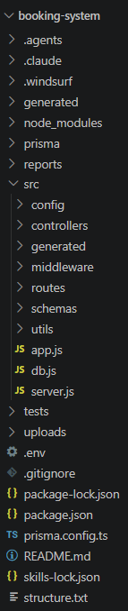

### 2. Реєстрація та авторизація

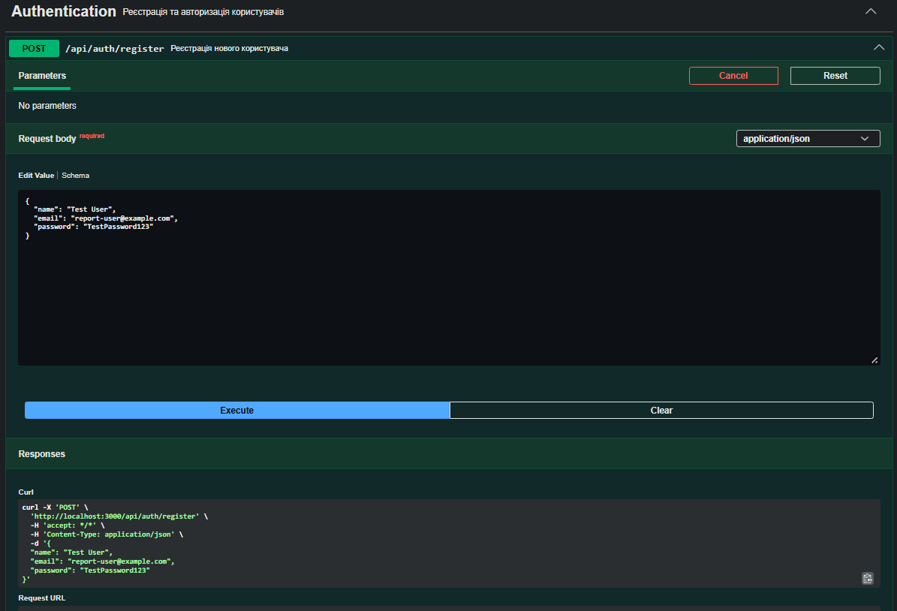
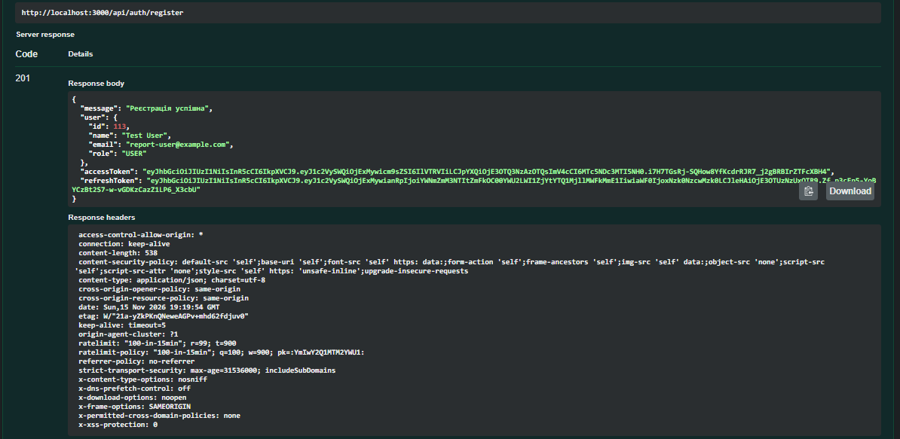

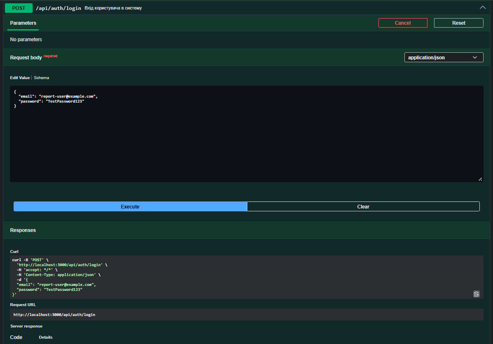
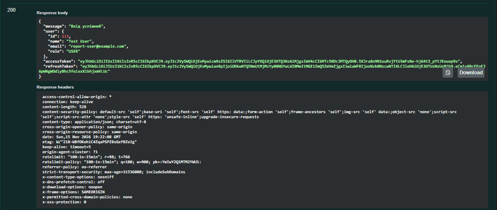

### 3. Авторизація за ролями

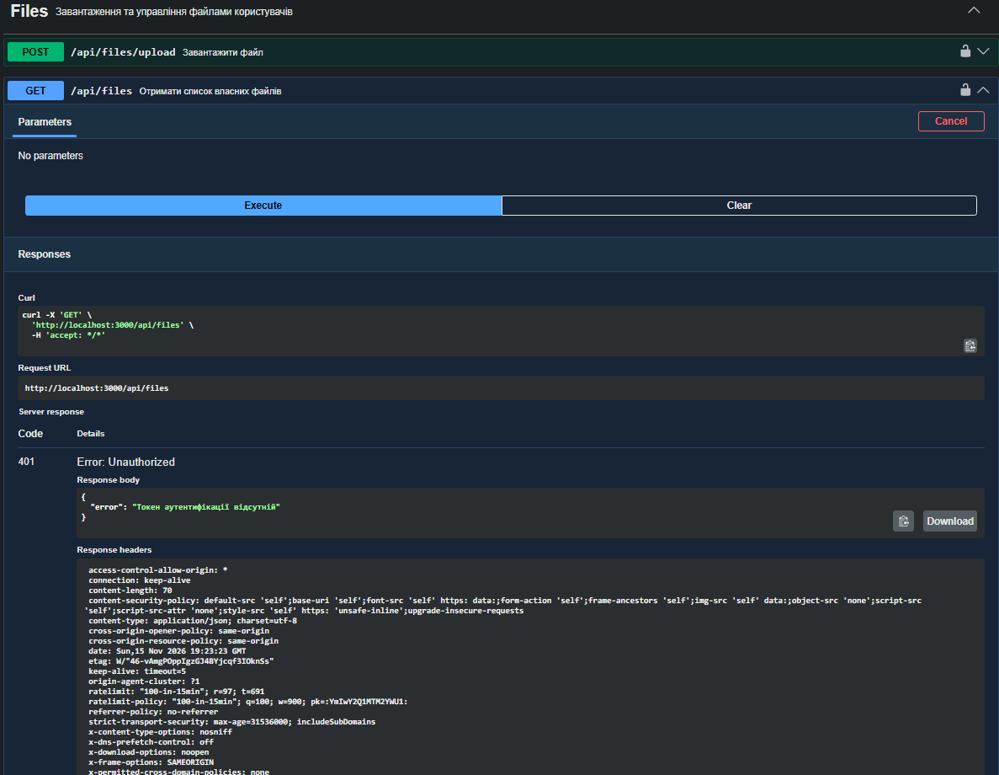

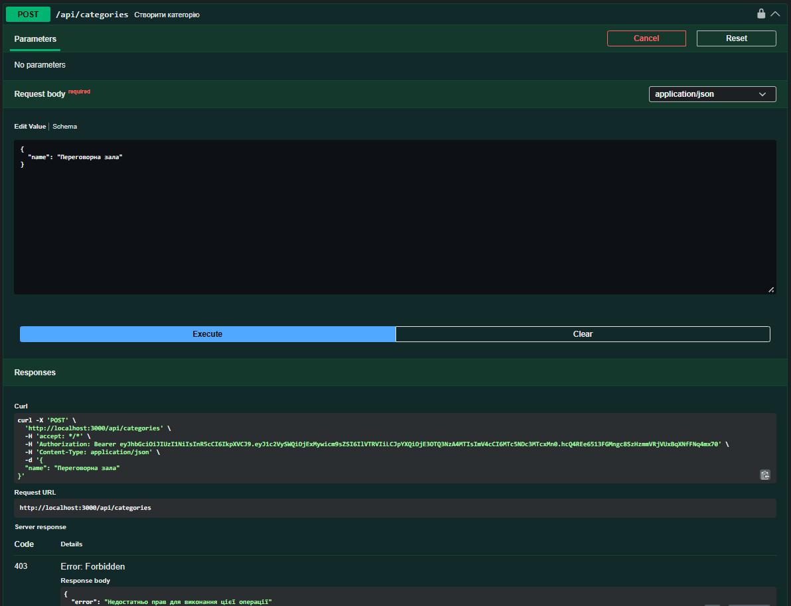

### 4. Робота з ресурсами та бронюваннями

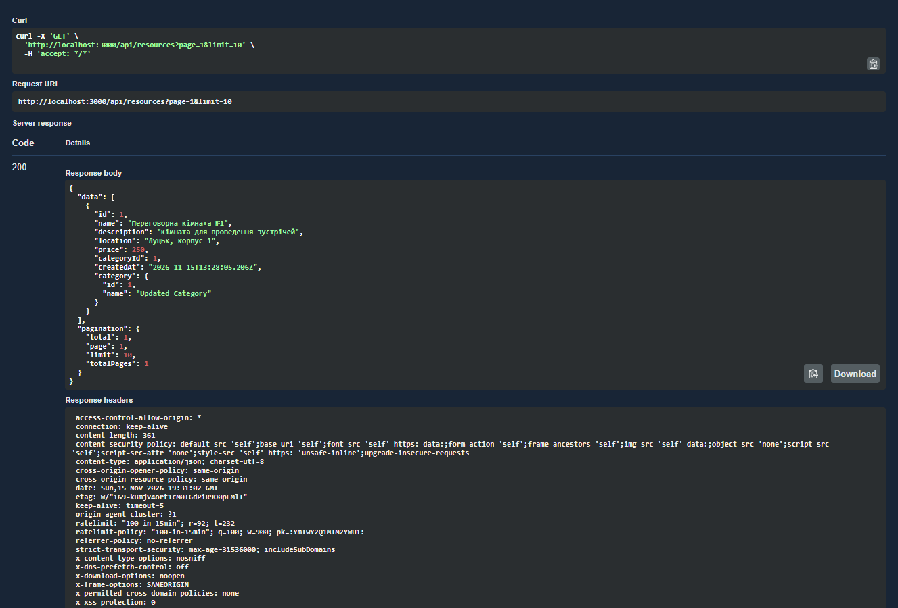

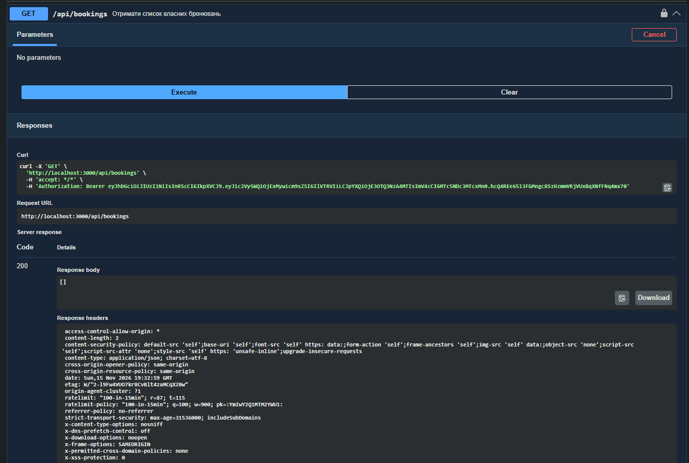

### 5. Завантаження файлів

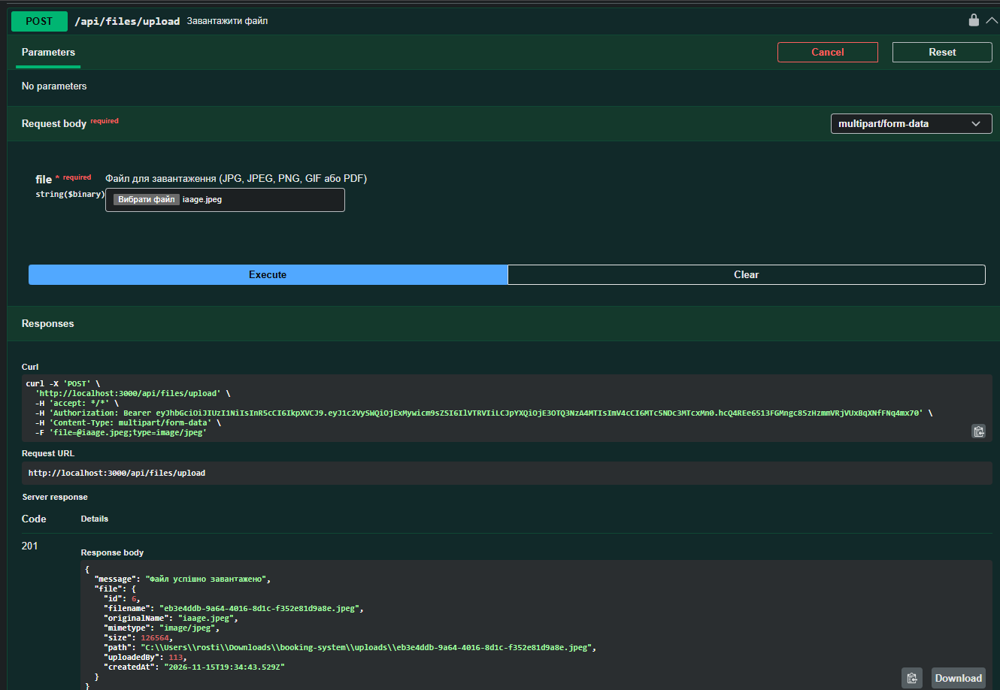

### 6. Автоматизоване тестування

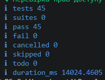

## Висновки

Під час виконання лабораторної роботи було розроблено Backend REST API для системи бронювання ресурсів із використанням Node.js та Express.js.

Було реалізовано механізми аутентифікації та авторизації користувачів, розмежування прав доступу за ролями USER та ADMIN, захищені маршрути, роботу з JWT та Refresh Token.

Також реалізовано додаткові модулі системи: бронювання, ресурси, категорії, сповіщення, обране та завантаження файлів. Для зберігання даних використано PostgreSQL та Prisma ORM.

Окрему увагу приділено безпеці застосунку, валідації вхідних даних, обробці помилок, документації API та автоматизованому тестуванню.

У результаті роботи створено функціональний Backend API, який успішно запускається, має Swagger-документацію та проходить розроблені інтеграційні тести.

**Самооцінка: 4/5**

**Обґрунтування:** Роботу виконано на високому рівні, реалізовано основні вимоги лабораторної роботи та додатковий функціонал. Забезпечено автентифікацію, авторизацію, розмежування прав доступу, валідацію даних, захист API та обробку помилок. Також розроблено інтеграційні тести для основних модулів системи, які успішно проходять. API задокументовано за допомогою Swagger, а проєкт має структуровану архітектуру та підключену базу даних PostgreSQL.
