# Звіт з лабораторної роботи 3

## Тема роботи: Взаємодія в реальному часі та фіналізація серверної частини

**Здобувач освіти:** [Величко Ростислав Володимирович]  
**Група:** [ІПЗ-42]  
**GitHub репозиторій:** https://github.com/Shin1-gami/booking-system  
**Рівень складності:** 3 (високий)

## Реалізований функціонал

У ході виконання лабораторної роботи було вдосконалено серверну частину інформаційної системи бронювання (Booking System), розробленої з використанням Node.js, Express.js, PostgreSQL, Prisma ORM та інших сучасних технологій.

Основна увага приділялася реалізації взаємодії між клієнтами в реальному часі, масштабуванню WebSocket-з'єднань, асинхронній обробці сповіщень, оптимізації роботи з даними, моніторингу та підготовці застосунку до розгортання.

У межах роботи реалізовано такі можливості:

### 1. Взаємодія в реальному часі за допомогою Socket.IO

- Реалізовано WebSocket-модуль на основі Socket.IO.
- Налаштовано автентифікацію WebSocket-з'єднань за допомогою JWT.
- Реалізовано приєднання користувачів до персональних кімнат.
- Додано обробку підключення та відключення клієнтів.
- Реалізовано механізм відстеження присутності користувачів.
- Передбачено отримання історії подій та підтвердження їх отримання.
- Реалізовано передавання подій користувачам через персональні кімнати.

### 2. Масштабування WebSocket за допомогою Redis

- Підключено Redis для зберігання інформації про активні підключення користувачів.
- Інтегровано Redis Adapter для Socket.IO.
- Налаштовано окремі Redis-клієнти для публікації та отримання повідомлень.
- Реалізовано облік декількох активних підключень одного користувача.
- Передбачено можливість обміну подіями між екземплярами Socket.IO через спільний Redis.

### 3. Розширена система сповіщень

- Додано чотири рівні пріоритету сповіщень: LOW, NORMAL, HIGH та URGENT.
- Реалізовано створення окремих сповіщень.
- Реалізовано пакетне створення сповіщень.
- Інтегровано BullMQ для асинхронної обробки завдань.
- Налаштовано повторні спроби виконання завдань у разі помилок.
- Реалізовано Notification Worker з можливістю паралельної обробки завдань.
- Налаштовано передавання нових сповіщень користувачам через Socket.IO.

### 4. Збереження та відновлення історії подій

- Використано модель UserEvent для збереження історії подій користувачів.
- Реалізовано запис подій до PostgreSQL.
- Передбачено отримання історії подій.
- Додано механізм підтвердження отримання подій.
- Реалізовано передавання подій через спільний механізм журналювання та Socket.IO.

### 5. Кешування даних за допомогою Redis

- Створено окремий модуль для роботи з кешем.
- Реалізовано отримання та збереження кешованих даних.
- Налаштовано час життя кешу (TTL).
- Реалізовано інвалідацію кешу після зміни даних.
- Використано версіонування кешу для уникнення використання застарілих записів.
- Інтегровано кешування у функції отримання ресурсів та категорій.

### 6. Оптимізація роботи PostgreSQL та Prisma ORM

- Оптимізовано вибірку даних за допомогою `select`.
- Реалізовано пагінацію для списків ресурсів та бронювань.
- Додано обмеження кількості записів на одну сторінку.
- Використано індекси для полів, які часто застосовуються у фільтрації та сортуванні.
- Оптимізовано виконання пов'язаних запитів до бази даних.
- Налаштовано параметри пулу підключень до PostgreSQL.

### 7. Моніторинг та журналювання

- Інтегровано Pino для структурованого журналювання.
- Підключено pino-http для журналювання HTTP-запитів.
- Реалізовано генерацію унікального ідентифікатора запиту.
- Додано централізовану обробку помилок.
- Створено endpoint `/health` для перевірки стану основних компонентів системи.
- Підключено prom-client для збору метрик.
- Створено endpoint `/metrics` для отримання статистики HTTP-запитів, тривалості обробки та кількості помилок.

### 8. Фіналізація серверної частини

- Упорядковано структуру серверного застосунку.
- Передбачено окремі команди запуску для розробки та продуктивного середовища.
- Налаштовано завершення роботи сервера із закриттям активних підключень.
- Передбачено закриття з'єднань із PostgreSQL, Redis та чергою завдань.
- Використано змінні середовища для зберігання конфігураційних параметрів.
- Підготовлено основу для локального запуску та розгортання застосунку.
- Передбачено оновлення документації REST API та опис WebSocket-подій.

## Ключові фрагменти коду

### 1. Підключення Redis Adapter до Socket.IO

Фрагмент демонструє налаштування Redis Adapter, який забезпечує обмін повідомленнями між екземплярами Socket.IO.

```javascript
import { createAdapter } from "@socket.io/redis-adapter";

import {
  redisPubClient,
  redisSubClient
} from "../config/redis.js";

io.adapter(
  createAdapter(redisPubClient, redisSubClient)
);
```

### 2. Реєстрація активного користувача в Redis

Для зберігання активних підключень використовується Redis. Це дає змогу відстежувати декілька одночасних Socket.IO-з'єднань одного користувача.

```javascript
const ONLINE_USERS_KEY = "presence:online-users";

// Ключі підключень користувача:
// presence:user:${userId}
```

Реєстрація та видалення підключень виконуються за допомогою Redis-операцій, що дає змогу підтримувати актуальний стан присутності користувачів.

### 3. Додавання сповіщень до черги BullMQ

```javascript
export async function enqueueNotification(notification) {
  const priority =
    NOTIFICATION_PRIORITIES[notification.priority] ??
    NOTIFICATION_PRIORITIES.NORMAL;

  return notificationQueue.add(
    "deliver-notification",
    { notificationId: notification.id },
    {
      priority,
      jobId: `notification-${notification.id}`
    }
  );
}
```

Функція додає сповіщення до черги із зазначенням пріоритету. Завдяки цьому обробка сповіщень відбувається асинхронно.

### 4. Пакетне додавання завдань до черги

```javascript
export async function enqueueNotifications(notifications) {
  if (!Array.isArray(notifications) || notifications.length === 0) {
    return [];
  }

  const jobs = notifications.map((notification) => ({
    name: "deliver-notification",
    data: { notificationId: notification.id },
    opts: {
      priority:
        NOTIFICATION_PRIORITIES[notification.priority] ??
        NOTIFICATION_PRIORITIES.NORMAL,
      jobId: `notification-${notification.id}`
    }
  }));

  return notificationQueue.addBulk(jobs);
}
```

Метод `addBulk()` дає змогу додавати декілька завдань до черги одним пакетним викликом.

### 5. Обробка сповіщень у Notification Worker

```javascript
const worker = new Worker(
  "notifications",
  async (job) => {
    const { notificationId } = job.data;

    const notification = await prisma.notification.findUnique({
      where: { id: notificationId }
    });

    if (!notification) {
      return {
        success: false,
        reason: "NOTIFICATION_NOT_FOUND"
      };
    }

    await publishUserEvent(
      io,
      notification.userId,
      "notification:new",
      notification
    );

    return {
      success: true,
      notificationId,
      userId: notification.userId
    };
  },
  {
    connection: queueRedisConnection,
    concurrency: 10
  }
);
```

Worker отримує завдання з черги, знаходить відповідне сповіщення в PostgreSQL та передає його потрібному користувачу через механізм подій Socket.IO.

### 6. Реалізація кешування Redis

```javascript
export async function setCache(key, data, ttl = 60) {
  try {
    if (!redisClient.isReady) return;

    await redisClient.setEx(
      key,
      ttl,
      JSON.stringify(data)
    );
  } catch (error) {
    console.error("Помилка запису Redis-кешу:", error);
  }
}
```

Функція зберігає дані в Redis із визначеним часом життя. Це дає змогу зменшити кількість повторних запитів до PostgreSQL.

### 7. Збір метрик HTTP-запитів

```javascript
export const httpRequestsTotal = new client.Counter({
  name: "booking_http_requests_total",
  help: "Загальна кількість HTTP-запитів",
  labelNames: ["method", "route", "status_code"],
  registers: [register]
});

export const httpRequestDuration = new client.Histogram({
  name: "booking_http_request_duration_seconds",
  help: "Тривалість обробки HTTP-запитів у секундах",
  labelNames: ["method", "route", "status_code"],
  registers: [register]
});
```

Лічильник і гістограма дають змогу збирати інформацію про кількість запитів і тривалість їх виконання.

## Скріншоти

**Скріншот 1. Структура серверного застосунку.**

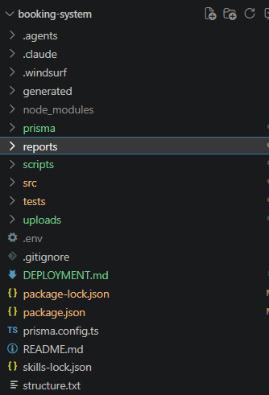

**Скріншот 2. Запуск серверної частини.**

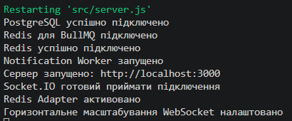

**Скріншот 3. Підключення декількох WebSocket-клієнтів.**

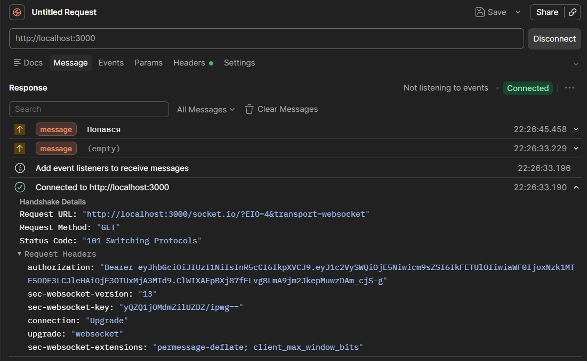

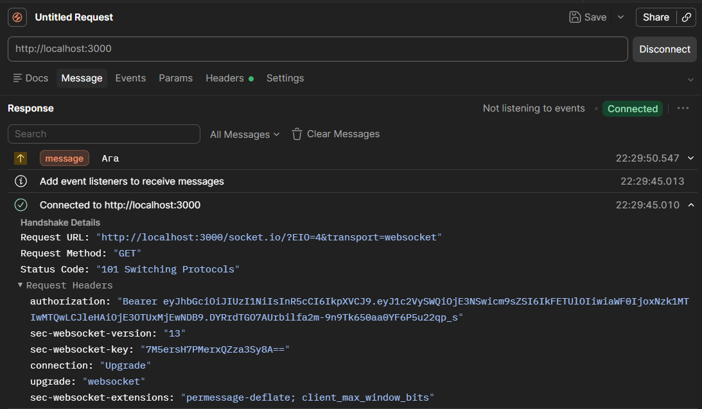

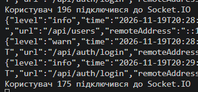

**Скріншот 4. Передавання подій у реальному часі.**

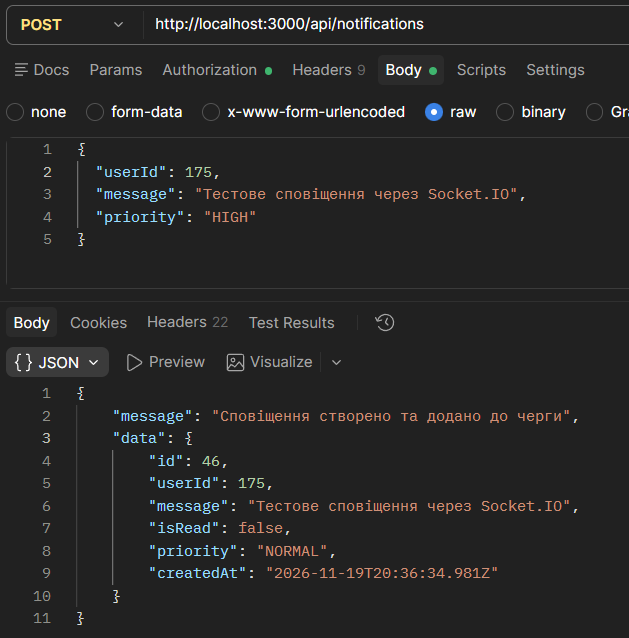

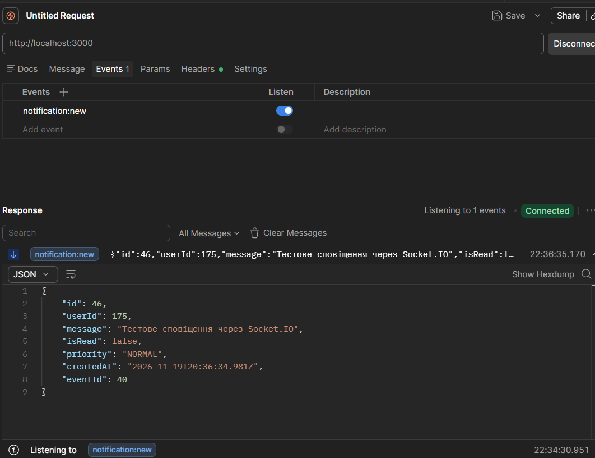

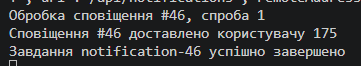

**Скріншот 5. Пакетне створення сповіщень.**

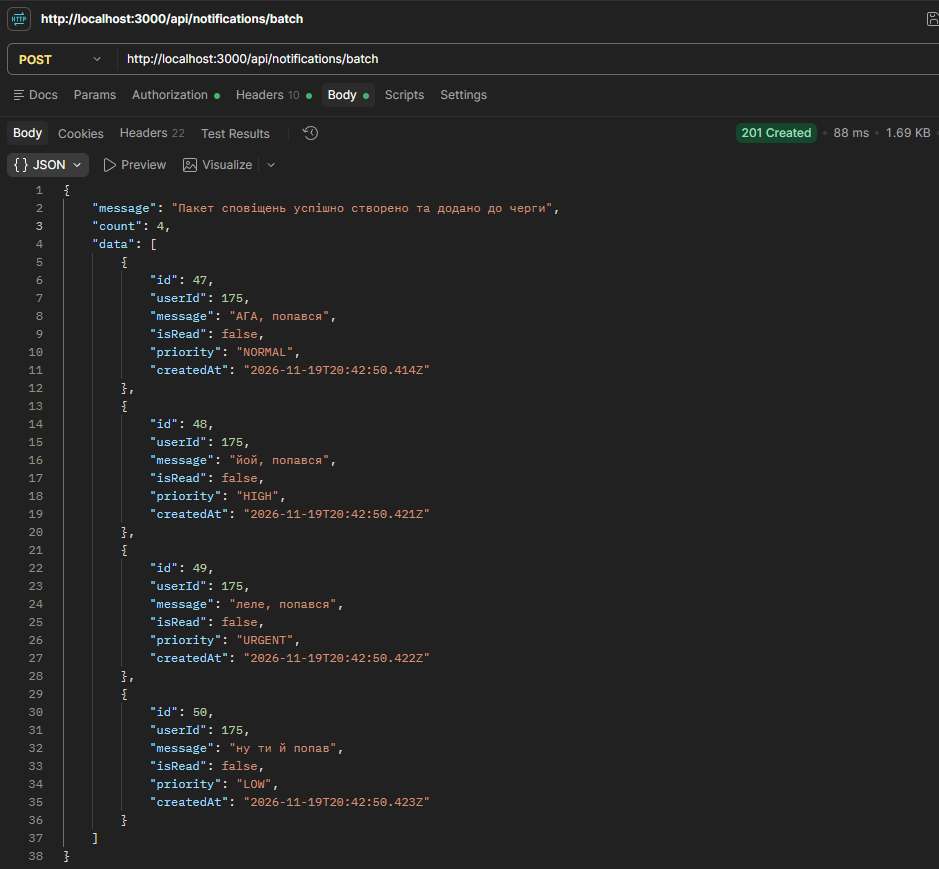

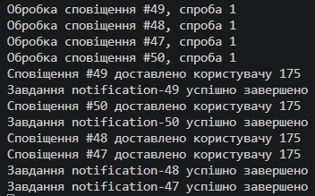

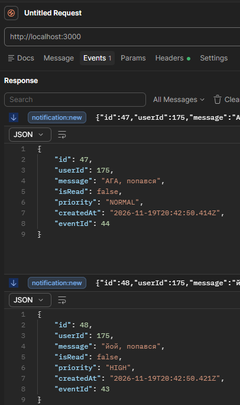

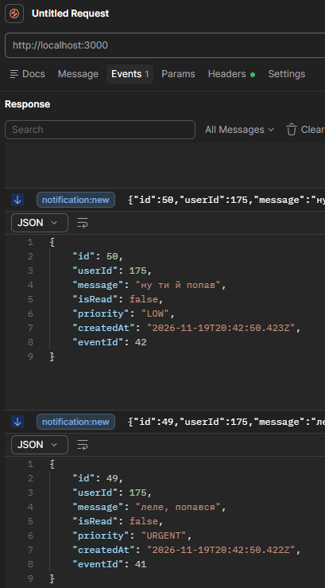

**Скріншот 6. Робота Notification Worker.**

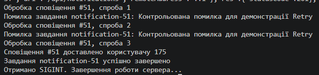

**Скріншот 7. Робота Redis.**

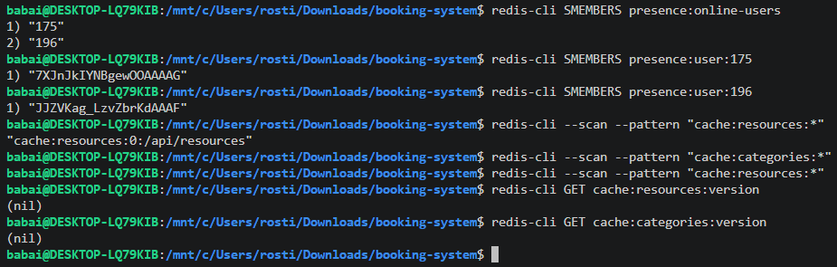

**Скріншот 8. Перевірка Health Check.**

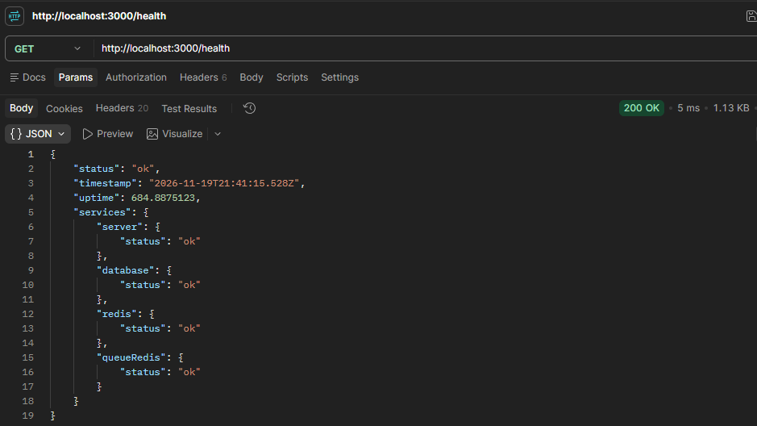

**Скріншот 9. Prometheus-метрики.**

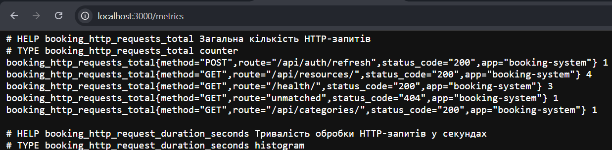

**Скріншот 10. Документація REST API та WebSocket.**

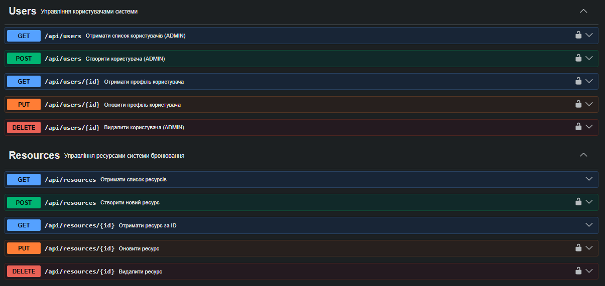

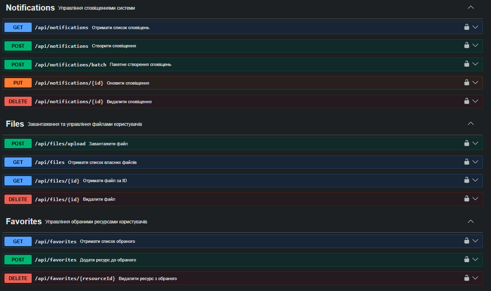

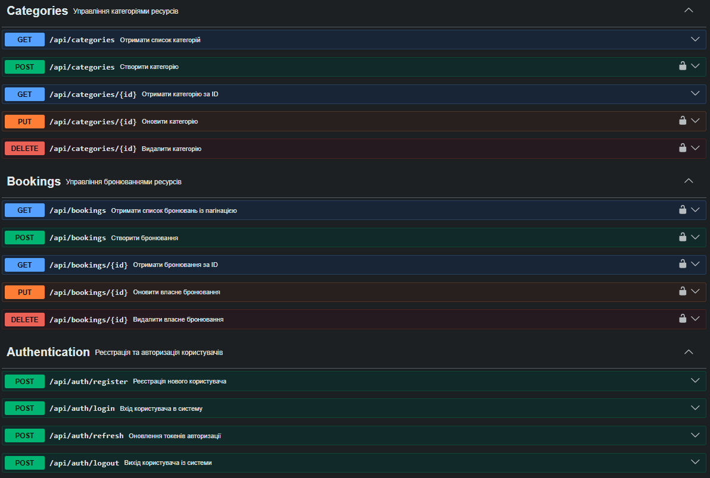

## Висновки

У результаті виконання лабораторної роботи було вдосконалено серверну частину інформаційної системи бронювання та реалізовано механізми взаємодії користувачів у реальному часі.

Було розширено WebSocket-модуль за допомогою Socket.IO та Redis Adapter, що створює можливість обміну подіями між різними екземплярами сервера. Реалізовано систему асинхронної обробки сповіщень на основі BullMQ з підтримкою пріоритетів, пакетного додавання завдань і повторних спроб виконання.

Для підвищення продуктивності системи впроваджено Redis-кешування, оптимізовано запити до PostgreSQL та налаштовано параметри пулу підключень. Додатково реалізовано збереження історії подій користувачів, структуроване журналювання, Health Check і збір метрик.

Також було передбачено механізми коректного завершення роботи сервера та підготовлено основу для локального запуску і продуктивного розгортання застосунку.

Таким чином, поставлені завдання з розширення серверної архітектури, реалізації взаємодії в реальному часі та підготовки застосунку до фінального використання були реалізовані на високому рівні.

**Самооцінка:** 5 (відмінно).

**Обґрунтування:** Робота охоплює комплексне вдосконалення серверної архітектури та реалізацію функціоналу високого рівня складності. Використано сучасні технології Node.js-екосистеми: Express.js, Prisma ORM, PostgreSQL, Redis, Socket.IO, BullMQ, Pino та prom-client. Реалізовано асинхронну обробку завдань, обмін подіями в реальному часі, кешування, оптимізацію запитів, журналювання та моніторинг. Окрему увагу приділено масштабуванню WebSocket, стабільності роботи серверних компонентів і підготовці документації. Висока самооцінка обґрунтовується обсягом реалізованого функціоналу та відповідністю вимогам третього рівня складності.